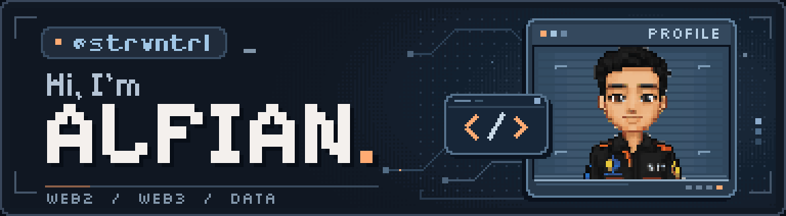

  <picture>
    <source media="(prefers-reduced-motion: reduce)" srcset="assets/profile-banner-static.png" />
    
  </picture>

  <strong>Information Systems undergraduate</strong> · Indonesia 
  Web &amp; systems development

  
  

## About me

I build **full-stack Web2 and Web3 apps**, from factory production systems to on-chain tools. I also work with **data analytics and business intelligence**, building dashboards that help teams track performance and make decisions.

## Selected projects

- **[Clutch Tech](https://github.com/strvntrl/clutch-tech)** — Dashboard for monitoring clutch disc production, with machine status and output-vs-target charts. 
  `Next.js` · `TypeScript` · `PostgreSQL`
- **[Dari Kami Untukmu](https://github.com/strvntrl/dari-kami-untukmu)** — Web app for creating, customizing, and sharing digital wedding invitations. 
  `Next.js` · `Tailwind CSS` · `Supabase`
- **[Hand Tracking Visual](https://github.com/strvntrl/hand-tracking-visual)** — Webcam app with 21 visual filters you can switch using hand gestures. 
  `Python` · `OpenCV` · `MediaPipe`

[Browse all repositories →](https://github.com/strvntrl?tab=repositories)

## Tech & tools

  <strong>FULL-STACK WEB</strong> 
  &nbsp;
  &nbsp;
  &nbsp;
  &nbsp;
  

  <strong>WEB3</strong> 
  &nbsp;
  &nbsp;
  &nbsp;
  

  <strong>DATA &amp; BI</strong> 
  &nbsp;
  &nbsp;
  &nbsp;
  

  <strong>WORKFLOW</strong> 
  &nbsp;
  &nbsp;
  &nbsp;
  &nbsp;
  

## GitHub activity

  

<picture>
  <source media="(prefers-color-scheme: dark)" srcset="https://raw.githubusercontent.com/strvntrl/strvntrl/pacman-output/pacman-contribution-graph-dark.svg" />
  
</picture>
